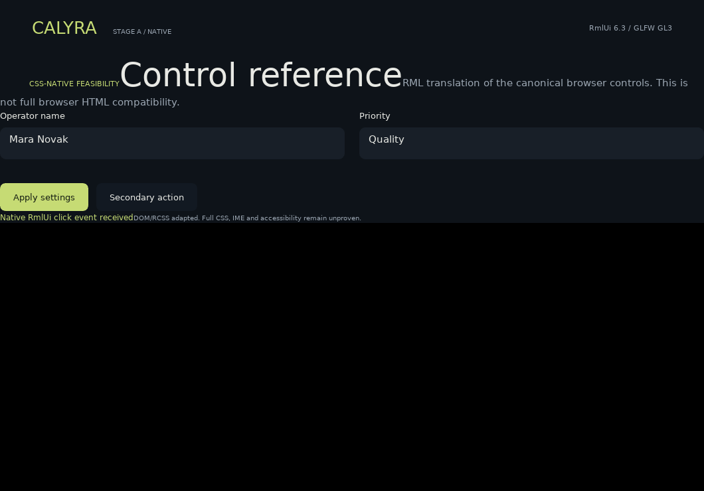

# CALYRA native RmlUi 6.3 evidence

This folder preserves **exact binary PNG outputs** from the first successful real RmlUi 6.3 Linux native execution, without relying on expiring GitHub Actions artifacts.

- [Adapted RCSS capture](rmlui-6.3-linux-adapted.png) · 1060×740 · 31,647 bytes · SHA-256 `5dc9c5fb0d28fc6befafca766524e82245025d1b1ca8420b6b0114cbca27b73f`
- [Direct CSS capture](rmlui-6.3-linux-direct.png) · 1060×740 · 2,959 bytes · SHA-256 `9abe44d95656648d856655ef5d34d906aed532cd2090c72f6b71e5d02f2b5be1`

## Provenance

- Verified [GitHub Actions run #43665651869](https://github.com/AVANT-ICONIC/calyra/actions/runs/43665651869), source commit `66248165cf384aead88b4032616e2919889d1f27`.
- [Original run logs and result JSON](https://github.com/AVANT-ICONIC/calyra/actions/runs/43665651869/artifacts/14142142998) (temporary, 7-day artifact retention).
- The PNG files were downloaded from that action, checked byte-for-byte using SHA-256, and committed without image editing or transcoding. The GitHub blob SHAs are `cf12865b2d353fce3dcaa56c004a84e9724f0484` and `3491e623f34a569248e575e68bd91051c69673aa`, respectively.
- Native renderer: official RmlUi 6.3 at `ba95ffe8bfb6370efb2cdcca927eaad4710c5413`, GLFW_GL3 using Mesa llvmpipe software OpenGL. **No hardware GPU was proven.**

## What these images do and do not show

Both scenes use **adapted RML markup**, not the browser HTML DOM. The direct mode passes the unchanged canonical `fixtures/reference.css` to the RmlUi parser, exposing severe CSS/selector/layout incompatibilities. The adapted mode uses a separately authored `native/rmlui/controls.rcss`; it is **not** full CSS compatibility. A synthetic internal RmlUi click and computed accent `#C6DB74` were verified in the adapted run. Neither screenshot proves OS-level input, accessibility, font parity, performance superiority, or visual parity with Chromium. Details: [Stage A observations](../stage-a-observations.md).

## Native results

