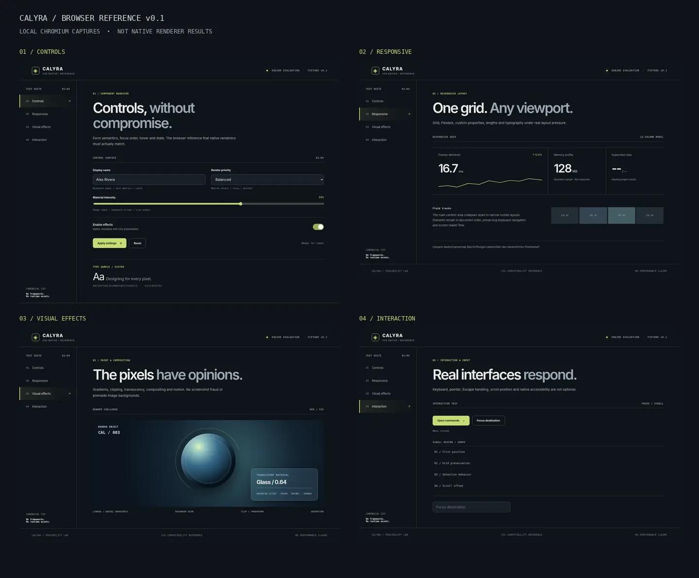

# CALYRA canonical reference fixtures



*Screenshot composite from local Chromium execution. Not native GPU engine evidence.*


These fixtures establish a browser baseline for the OpenSpec change `establish-native-css-feasibility`. They are **not** a CALYRA GPU renderer, engine adapter, Tauri baseline, or performance benchmark.

## Files

- `index.html`: one DOM tree with four selectable views.
- `reference.css`: normal CSS; no custom language, external fonts, or remote assets.
- `reference.js`: tiny browser-reference interaction controller (native engine adapters must reimplement semantics and disclose adaptations).
- `manifest.json`: versioned fixture IDs, action traces and required feature probes.
- `../tests/test_reference.py`: local visual/interaction smoke tests.

## Run manually

Serve `fixtures/` from a local static HTTP server, such as `python3 -m http.server --directory fixtures 8000`, then open:

- `http://localhost:8000/?fixture=controls&motion=off`
- `http://localhost:8000/?fixture=dashboard&motion=off`
- `http://localhost:8000/?fixture=visual&motion=off`
- `http://localhost:8000/?fixture=interaction&motion=off&state=menu-open`

Use the same CSS pixel viewport, device scale factor, fixture state and system font configuration across candidates.

## Local browser smoke tests

Requires Python 3, `playwright` for Python, and Chromium. No npm dependencies.

```bash
python3 -m pip install playwright
python3 -m playwright install chromium
python3 tests/test_reference.py
```

To use a system Chromium binary, set `CALYRA_CHROMIUM_EXECUTABLE`. The test runner generates screenshots in `evidence/`, which is gitignored.

**Sandbox caveat:** the automated tests load the canonical DOM, CSS and controller via Playwright's `set_content` / `add_style_tag` / `add_script_tag` because this sandbox blocks both `file://` and localhost Chromium navigation. Thus these checks exercise layout, CSS, state and pointer/keyboard behavior but do **not** test HTTP asset loading or link navigation. Those require a normal browser environment or a packaged WebView and remain unverified.

## Supported test assertions

Eight local smoke test groups exercise actual static asset serving, active fixture selection, controls and state reset, dropdown Escape/focus restoration, scrollability, snapshot-state selection, responsive overflow at widths 320/390/650/900/1440 CSS pixels, and desktop/mobile screenshot capture. Passing them does not prove accessibility-tree conformance, IME, GPU rendering performance, native CSS parsing, or any native application integration.

## Fair comparison policy

No candidate may change the canonical source to hide unsupported CSS. All translations must be documented per engine. The dashboard contains *illustrative* numbers only; they are **not measured benchmark results**.
